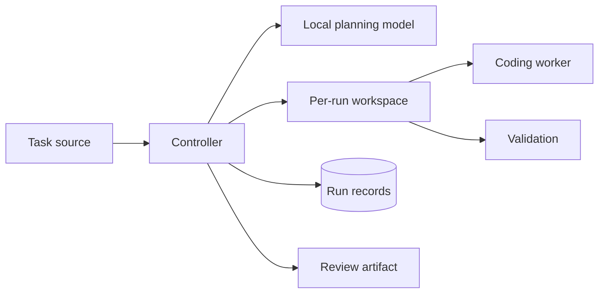

# High-level design

This document specifies the system boundary. [Runtime](runtime.md) describes the CLI's implemented behavior.

## Purpose

Turn a bounded engineering task into a reviewable code change or an evidence-backed report. Merge approval belongs to a human.

## Components



| Component | Responsibility |
| --- | --- |
| Task source | Supplies the objective, repository, and acceptance criteria. GitHub Issues is the issue source. |
| Controller | Owns run state, limits, retries, tool access, and publication. |
| Local planning model | Proposes steps, checks, and risks; its output is advisory. |
| Workspace | Pins the base commit and separates each run's files and processes. |
| Coding worker | Investigates and edits within the workspace. Its model is replaceable. |
| Validation | Runs explicit checks and records results against the final diff. |
| Review artifact | Presents a pull request or investigation report with findings, checks, and uncertainty. |

## GitHub issue intake

An installed GitHub App observes only configured repositories. An open issue with the `agent:run` label is eligible; opening or editing an unlabelled issue does not start work. Webhook events prompt intake, and a periodic scan reconciles eligible issues after missed or out-of-order deliveries. Both paths use the same claim operation. Without a reachable HTTPS webhook endpoint, the scan is the sole trigger.

The webhook handler verifies `X-Hub-Signature-256`, records the delivery, and acknowledges it without running a model. The controller fetches the current issue before claiming it, then stores an immutable task snapshot. A unique key on installation, repository, issue number, and run generation prevents duplicate runs. An edit does not change an active snapshot or silently restart a finished run. An explicit new generation is required to rerun.

Removing `agent:run` or closing the issue cancels unfinished work. The controller records the reason and the evidence collected so far. Issue text remains untrusted input; it cannot change tool permissions or execution limits.

## Run contract

Input: task identity, task text, repository, acceptance criteria, base commit, execution limits, and validation commands. Repeated delivery of the same task must resolve to the same run ID.

The controller persists state before each external side effect. On restart, it reconciles the worktree and review artifact by run ID before retrying. Retries have explicit limits; cancellation stops the worker and records the partial result.

```text
accepted → planning → executing → validating → reviewable
                                  ↘ inconclusive
Any active state → failed | cancelled
```

The worker can propose actions but cannot grant itself publication permissions or approve its own work. It treats the plan as a hypothesis and checks it against repository evidence before editing.

Outcomes are a reviewable change, an inconclusive investigation, or a failure. An inconclusive result states what was inspected, what was tested, and what evidence is missing. A successful process exit alone is not a validated change.

## Evidence and review

Each result identifies the task, base commit, final diff or commit, changed files, worker output, check commands and exit codes, and unresolved risks. Validation runs after worker execution. A reviewable change requires at least one relevant check. The review artifact distinguishes tests that passed from tests that were not run.

Human review controls merge. Automated review may find defects but cannot replace that gate.

## Trust boundary

Task text, repository files, and model output are untrusted inputs. Code execution runs with bounded resources and without publication credentials. The controller uses a separate, scoped identity for repository writes. Execution and publication are distinct operations.
