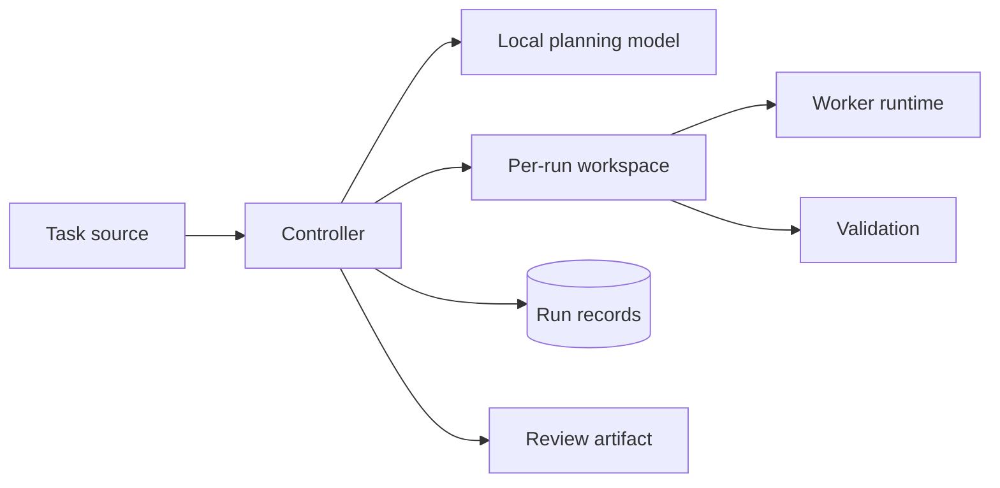

# High-level design

This document specifies the system boundary. [Runtime](runtime.md) describes the CLI's implemented behavior.

## Purpose

Turn a bounded engineering task into a reviewable code change or an evidence-backed report. Merge approval belongs to a human.

## Components



| Component | Responsibility |
| --- | --- |
| Task source | Supplies the objective, repository, and acceptance criteria. GitHub Issues is the issue source. |
| Controller | Owns run state, limits, retries, tool access, and publication. |
| Local planning model | Proposes steps, checks, and risks; its output is advisory. |
| Workspace | Pins the base commit and separates each run's files and processes. |
| Worker runtime | Investigates and edits within the workspace. It may coordinate its own agents; the controller treats it as one execution. |
| Validation | Runs explicit checks and records results against the final diff. |
| Review artifact | Presents a pull request or investigation report with findings, checks, and uncertainty. |

Planner and worker providers expose independent typed contracts. The controller records their identities and sanitized configuration summaries with each run.

The controller schedules engineering runs, not individual agents inside a worker runtime. It supplies one task and worktree, then observes one bounded result. The runtime decides whether to use one agent or coordinate several. The controller retains the run's permissions, resource limits, cancellation, validation, state, and publication. Internal agent roles, messages, and task lists are not controller state.

## GitHub issue intake

An installed GitHub App observes only configured repositories. An open issue with the `agent:run` label is eligible; opening or editing an unlabelled issue does not start work. Webhook events prompt intake, and a periodic scan reconciles eligible issues after missed or out-of-order deliveries. Both paths use the same claim operation. Without a reachable HTTPS webhook endpoint, the scan is the sole trigger.

The webhook handler verifies `X-Hub-Signature-256`, records the delivery ID, and acknowledges it without fetching an issue or running a model. A separate processor retries persisted deliveries and reconciles the current issue by number; a periodic full scan covers missed deliveries. A unique key on installation, repository, issue number, and run generation prevents duplicate runs. An edit does not change an active snapshot or silently restart a finished run. An explicit new generation is required to rerun.

Removing `agent:run` or closing the issue cancels unfinished work. The controller composes this external signal with operator cancellation, persists the first observed reason in the run record, and stops an active worker or check while retaining partial evidence. Issue text remains untrusted input; it cannot change tool permissions or execution limits.

The polling interface returns claims until dispatch is acknowledged and cancellations until work has stopped. A unique SQLite key covers installation ID, repository ID, issue number, and generation. Claims snapshot the current issue text and use GitHub's native blocking relationships. The controller consumes both decisions by run ID.

## Scheduling

The controller verifies an active claim, queues its immutable snapshot, and acknowledges handoff in one SQLite transaction. Dispatch rechecks that issue-backed claims remain active. A SQLite transaction dispatches the oldest eligible run while enforcing global and per-repository limits. Independent repositories can run concurrently; a busy repository does not block another. A single controller lock prevents competing dispatch loops. After a restart, queued runs remain eligible. Interrupted runs need review and retain their capacity reservation until the controller confirms their process and container have stopped. Cancellation requests stay durable until the execution callback stops the run.

## Run contract

Input: task identity, task text, repository, acceptance criteria, base commit, execution limits, and validation commands. Repeated delivery of the same task must resolve to the same run ID.

The controller persists state before each external side effect. On restart, it reconciles the worktree and review artifact by run ID before retrying. It never repeats worker or validation commands after an uncertain interruption; those runs need review. A failed or cancelled run can start one fresh child generation at the same base commit, up to three retries. Cancellation stops the worker or check and records the reason and partial output.

```text
accepted → planning → workspace_pending → executing → validating → reviewable (change | investigation report)
                                                      ↘ inconclusive
Any active state → failed | cancelled
```

The worker can propose actions but cannot grant itself publication permissions or approve its own work. It treats the plan as a hypothesis and checks it against repository evidence before editing. Tasks declare investigation or implementation mode. An investigation can finish with a report and no diff; implementation requires a validated change.

Outcomes are a reviewable change, a reviewable investigation report, an inconclusive investigation, or a failure. A reviewable report answers the task with supporting evidence and needs no diff. An inconclusive result states what was inspected, what was tested, and what evidence is missing. A successful process exit alone is not a validated result.

## Evidence and review

Each result identifies the task, base commit, final diff or commit, changed files, worker output, check commands and exit codes, and unresolved risks. Each check records its argument vector, start time, duration, exit code, status, and bounded output. Validation records a hash of the diff before and after checks; a changed hash invalidates the result. A reviewable change requires at least one relevant check. The review artifact distinguishes tests that passed from tests that were not run.

Publication evidence records the merged SHA, CI or deployment run, target, smoke-check result, and rollback target when applicable. A merged PR alone does not establish delivery.

After the worker runtime returns one result, an independent reviewer runs as an external run-level validation step. It receives only the task, validated diff, and check evidence. Its file/line findings are advisory, keyed to the validated diff, and shown to the human reviewer. It has no workspace or publication tools and does not join or direct the runtime's internal agents. Human review controls merge.

For a validated implementation run, the controller rechecks the diff identity before committing the run branch. It publishes with a GitHub App token limited to the claimed repository, then finds or creates one PR for the run ID. The PR links the issue and states the base SHA, validated diff identity, checks, risks, and unverified work. Investigation outcomes are not published as code changes.

## Evaluation

The [benchmark suite](benchmarks.md) runs bounded tasks against versioned fixture repositories. It retains the fixture digest, base commit, complete run evidence, an implementation oracle or investigation rubric, and measured latency. Intervention and cost are recorded when supplied; missing measurements stay unknown. Inconclusive reports are counted separately from failures.

## Trust boundary

Task text, repository files, and model output are untrusted inputs. Code execution runs with bounded resources and without publication credentials. The controller uses a separate, scoped identity for repository writes. Execution and publication are distinct operations.
